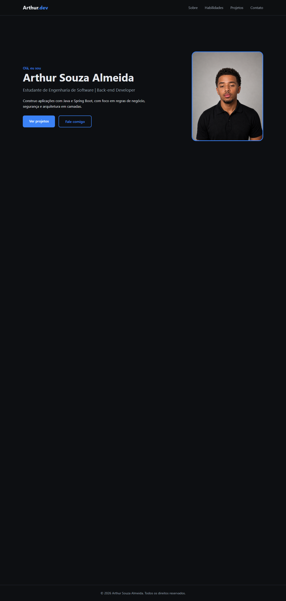
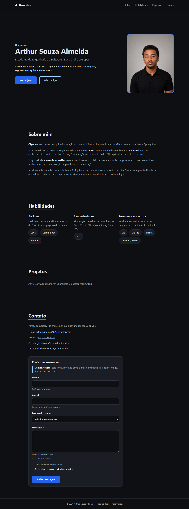
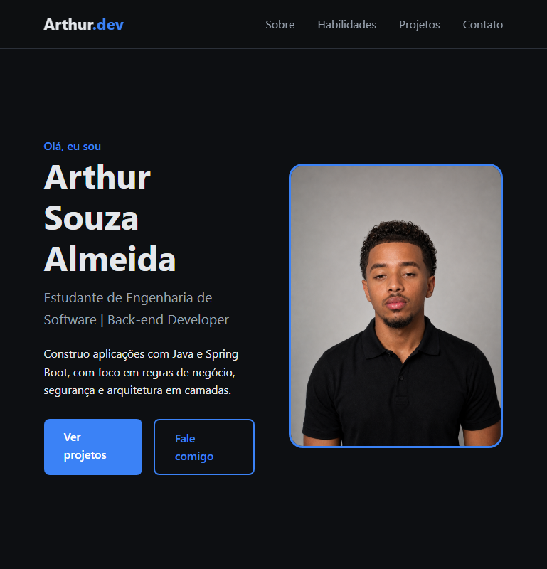
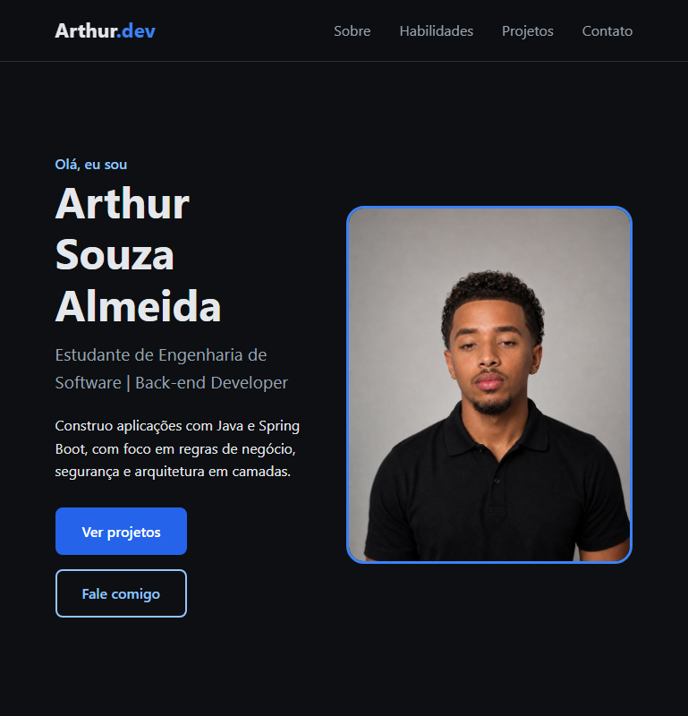
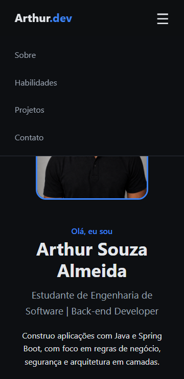
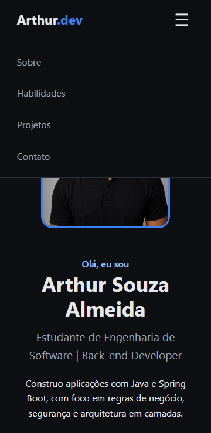

# Registro técnico do portfólio

**Autor:** Arthur Souza Almeida · **Disciplina:** Programação Front-End · **Profa.:** Daniele Virgens

Sumário:
1. [Diagnóstico](#1-diagnóstico)
2. [Evidências de antes e depois](#2-evidências-de-antes-e-depois)
3. [Conteúdo e navegação](#3-conteúdo-e-navegação)
4. [Filtro de projetos](#4-filtro-de-projetos)
5. [Layout e acessibilidade](#5-layout-e-acessibilidade)
6. [Refatoração](#6-refatoração)
7. [Formulário de contato: decisões](#7-formulário-de-contato-decisões)
8. [Matriz de testes](#8-matriz-de-testes)
9. [Revisão do colega](#9-revisão-do-colega)
10. [Limitações e melhorias futuras](#10-limitações-e-melhorias-futuras)

---

## 1. Diagnóstico

Os problemas abaixo foram encontrados na versão anterior do portfólio. A ordem segue o **impacto no visitante**: primeiro o que esconde conteúdo ou impede o uso, depois o que dificulta a leitura e, por fim, o que afeta manutenção e desempenho.

| # | Tipo | Prioridade | Local |
|---|---|---|---|
| P1 | Funcional | **Alta** | `style.css` (`.revelar`) |
| P2 | Acessibilidade | **Alta** | `style.css` (`.btn-primario`, `.tags li`) |
| P3 | Acessibilidade | **Alta** | `index.html` (`#menuToggle`) e `script.js` |
| P4 | Responsividade | Média | `style.css` (`.hero-foto`, `.botoes`) |
| P5 | Organização do código | Média | `index.html` (seção Projetos) |
| P6 | Desempenho | Média | `img/foto.jpg` |
| P7 | Conteúdo | Média | Cards de projetos |

### P1 — Seções invisíveis quando o JavaScript não roda (Funcional, Alta)
- **Passos para reproduzir:** desativar o JavaScript no navegador (DevTools → Ctrl+Shift+P → "Disable JavaScript") e recarregar a página.
- **Comportamento atual:** só aparecem o topo e o rodapé. Sobre, Habilidades, Projetos e Contato ficam com `opacity: 0`, porque o CSS escondia `.revelar` sempre e só o JS mostrava.
- **Comportamento esperado:** todo o conteúdo deve ficar legível mesmo se o script falhar, for bloqueado ou demorar a carregar.
- **Por que é alta:** o visitante perde todo o conteúdo, inclusive o contato.
- **Correção:** um script inline no `<head>` adiciona a classe `js` ao `<html>`, e o CSS só esconde com `.js .revelar`. Sem JS, nada é escondido.

### P2 — Contraste insuficiente no botão principal e nas tags (Acessibilidade, Alta)
- **Passos para reproduzir:** inspecionar o botão "Ver projetos" e medir o contraste do texto branco sobre `#3b82f6`.
- **Comportamento atual:** **3,68:1** no botão e **3,60:1** nas tags (azul `#3b82f6` sobre `#2b3039`), abaixo do mínimo de **4,5:1** da WCAG AA para texto normal.
- **Comportamento esperado:** pelo menos 4,5:1.
- **Por que é alta:** quem tem baixa visão ou usa o celular no sol tem dificuldade para ler o botão principal da página.
- **Correção:** botão com fundo `#2563eb` (**5,17:1**) e textos azuis sobre fundos cinza com `#93c5fd` (**7,35:1**).

### P3 — Menu móvel não informa o estado e não fecha pelo teclado (Acessibilidade, Alta)
- **Passos para reproduzir:** em uma tela de 360 px, navegar com Tab até o botão ☰ e apertar Enter.
- **Comportamento atual:** o menu abre, mas o botão não tem `aria-expanded`, então o leitor de tela sempre anuncia só "Abrir menu". A tecla Esc não fecha o menu. Também faltava foco visível personalizado e um atalho para pular o cabeçalho.
- **Comportamento esperado:** o estado (aberto/fechado) deve ser anunciado, o Esc deve fechar o menu e devolver o foco ao botão, e o foco deve ser bem visível.
- **Correção:** `aria-expanded` e `aria-controls` no botão, função `definirMenuAberto()` que atualiza classe, `aria-expanded` e rótulo juntos, Esc fecha o menu, contorno `:focus-visible` e link "Pular para o conteúdo".

### P4 — Botões quebram e a foto é espremida logo acima de 768 px (Responsividade, Média)
- **Passos para reproduzir:** abrir a página com a janela em **769 px** de largura.
- **Comportamento atual:** o texto dos botões quebra em duas linhas ("Ver / projetos", "Fale / comigo") e os botões ficam com **79 px** de altura em vez de 54. A foto é encolhida para **302 px** de largura (em vez de 320).
- **Comportamento esperado:** botões em uma linha e foto no tamanho definido.
- **Correção:** `flex-shrink: 0` na foto e `flex-wrap: wrap` nos botões também no desktop.

### P5 — Projetos duplicados no HTML, sem fonte única de dados (Organização, Média)
- **Local:** `index.html`, três blocos `<article>` copiados e colados.
- **Comportamento atual:** cada projeto repete a mesma marcação. Para adicionar um campo (por exemplo "Público") é preciso editar três lugares. Também não daria para filtrar sem duplicar regras.
- **Comportamento esperado:** os dados ficam em um lugar e a marcação é gerada por uma função.
- **Correção:** lista `projetos` no `script.js` e função `criarCardProjeto()` (veja a [Refatoração](#6-refatoração)).

### P6 — Foto de perfil com 1,8 MB (Desempenho, Média)
- **Passos para reproduzir:** DevTools → aba Network → recarregar → ver o tamanho de `foto.jpg`.
- **Comportamento atual:** **1.810.439 bytes** (1086×1448 px) para uma imagem exibida em 320×400.
- **Comportamento esperado:** um arquivo leve, sem perda visível. No 4G isso atrasa a primeira tela.
- **Correção:** foto redimensionada para 640×853 (o dobro do tamanho exibido, para telas de alta densidade), resultando em **38.578 bytes** (−98%).

### P7 — Projetos sem contexto, imagem e links (Conteúdo, Média)
- **Comportamento atual:** dois dos três projetos não tinham nenhum link, e nenhum tinha imagem, problema abordado, público ou contribuição.
- **Correção:** cada projeto agora mostra problema, público, contribuição, tecnologias, imagem e link.

---

## 2. Evidências de antes e depois

Os prints estão em [`docs/evidencias/`](evidencias/). Foram gerados no Chrome em modo headless, com a largura emulada.

### P1 — Conteúdo sem JavaScript
| Antes | Depois |
|---|---|
|  |  |

Antes, sem JS só sobravam o topo e o rodapé. Depois, todas as seções aparecem (os projetos mostram o aviso `<noscript>` com o link do GitHub).

### P4 — Largura de 769 px
| Antes | Depois |
|---|---|
|  |  |

| Medida | Antes | Depois |
|---|---|---|
| Altura dos botões | 79 px | 54 px |
| Largura da foto | 302 px | 320 px |

### P3 — Menu móvel (360 px)
| Antes | Depois |
|---|---|
|  |  |

| Atributo do botão ☰ | Antes | Depois |
|---|---|---|
| `aria-expanded` ao carregar | *(não existe)* | `false` |
| `aria-expanded` após clicar | *(não existe)* | `true` |
| Esc fecha o menu | não | sim, e o foco volta ao botão |

### P2 e P6 — Medições
| Medida | Antes | Depois |
|---|---|---|
| Fundo do botão principal | `rgb(59, 130, 246)`, contraste 3,68:1 | `rgb(37, 99, 235)`, contraste 5,17:1 |
| Tamanho de `foto.jpg` na aba Network | 1.810.439 bytes | 38.578 bytes |

---

## 3. Conteúdo e navegação

- **Apresentação:** objetivo profissional (primeiro estágio em back-end), trajetória (UCSAL, 4 anos de atendimento e manutenção, bootcamp) e habilidades agrupadas por contexto de uso (Back-end, Banco de dados, Ferramentas).
- **Projetos:** três projetos pessoais (identificados como "Projeto pessoal") com problema, público, contribuição, tecnologias, imagem e link.
- **Menu:** âncoras `#sobre`, `#habilidades`, `#projetos` e `#contato`. Cada `<section>` tem `aria-labelledby` apontando para o seu título. O `scroll-padding-top` evita que o cabeçalho fixo cubra o título ao pular para uma seção.
- **Botões e links:** "Ver projetos" e "Fale comigo" levam às seções, os links dos cards abrem em nova aba com `rel="noopener"`, `mailto:` abre o e-mail e `tel:` liga. Não existe currículo na página, por isso não há botão de currículo.

---

## 4. Filtro de projetos

- **Dados separados do filtro:** os projetos ficam na lista `projetos`. O filtro só lê `projeto.categorias` (função `filtrarProjetos`).
- **Botões gerados a partir dos dados:** `criarBotoesFiltro()` junta as categorias de todos os projetos com `new Set` (sem repetir) e adiciona "Todos". Um projeto novo com uma categoria nova ganha o botão automaticamente.
- **Sem recarregar e sem duplicar:** `mostrarProjetos()` usa `replaceChildren`, que remove os cards antigos antes de inserir os novos.
- **Quantidade:** um parágrafo com `aria-live="polite"` mostra, por exemplo, "2 projetos encontrados em "Terminal"", e o leitor de tela anuncia a mudança.
- **Estado ativo:** `aria-pressed="true"` no botão selecionado. Visualmente ele fica com fundo azul **e** ganha um "✓", então o estado não depende só da cor.
- **Sem resultados:** aparece a mensagem "Nenhum projeto encontrado nesta categoria. Clique em "Todos"...".
- **Teclado:** os filtros são `<button>`, então funcionam com Tab, Enter e Espaço. Os links dos cards continuam acessíveis pelo Tab.
- **Teste do estado vazio:** como todo botão vem de uma categoria existente, criei a condição temporária pelo console com `mostrarProjetos('Python')` (resultado no teste T13).

---

## 5. Layout e acessibilidade

| Item | Como foi resolvido | Verificação |
|---|---|---|
| Sem rolagem horizontal | `img { max-width: 100% }`, grids com `auto-fit`/`minmax`, `flex-wrap` | `scrollWidth = clientWidth` em 360, 768, 1280 e zoom 200% (seção 8) |
| Imagens com proporção | `aspect-ratio: 16/9` + `object-fit: cover` nos cards; `object-fit` na foto | prints em `evidencias/depois-pagina-*.png` |
| Textos longos e URLs | `overflow-wrap: anywhere` nos cards e nos links de contato | e-mail cabe em 360 px |
| Estrutura | um `h1`; `h2` por seção; `h3` nos cards e nos grupos; `header`, `nav`, `main`, `section`, `article`, `footer`; `alt` descritivo nas imagens | — |
| Foco visível | `:focus-visible` com contorno de 3 px `#93c5fd` | T11 |
| Uso sem mouse | link "Pular para o conteúdo", menu com Enter/Esc, filtros como `<button>` | T11, T12 |
| Contraste | botão 5,17:1, textos azuis 7,35:1, texto cinza 7,53:1 | P2 |
| Erros e estados sem depender de cor | erros com "⚠" + texto; status começa com "Erro:", "Falha:", "Sucesso:"; filtro ativo com "✓" | T01, T09 |
| Movimento reduzido | `@media (prefers-reduced-motion: reduce)` desliga a animação, o hover que move os cards e a rolagem suave | T14 |

---

## 6. Refatoração

**Escolhida: projetos como dados + função que cria o card (P5).**

- **Problema anterior:** os três projetos eram blocos `<article>` copiados e colados no HTML. Mudar a estrutura de um card (por exemplo, incluir "Público" e "Minha contribuição") exigia editar três lugares iguais, com risco de esquecer um. Para criar o filtro seria preciso esconder e mostrar elementos com regras espalhadas.
- **Mudança:** os dados foram para a lista `projetos` no `script.js`. Cada responsabilidade ganhou uma função pequena:
  - `criarCardProjeto(projeto)` monta um card (só apresentação);
  - `filtrarProjetos(categoria)` decide quais projetos entram (só regra);
  - `mostrarProjetos(categoria)` junta as duas, atualiza contagem, mensagem de vazio e estado do botão.
  - Todo texto é inserido com `textContent`/`append`, **nunca com `innerHTML`**.
- **Por que facilita manutenção e teste:** um projeto novo é um objeto a mais na lista. A regra do filtro pode ser testada sozinha (`filtrarProjetos('Terminal')` devolve 2 itens) sem depender do HTML. Como cada função faz uma coisa, um erro aponta direto para o lugar certo.

No mesmo espírito, o JS do formulário foi dividido em blocos: **seleção dos elementos → leitura e normalização (`lerDados`) → regras (`validadores`) → apresentação de erros (`mostrarErroCampo`, `mostrarResumoErros`, `mostrarStatus`) → processamento (`aoEnviarFormulario`)**. Os dois listeners por link do menu viraram **um único listener** no `<nav>` (delegação de eventos).

**Console e Network:** na versão final, nenhum erro apareceu no console e nenhum recurso falhou na aba Network (todos os arquivos carregaram: `index.html`, `style.css`, `script.js`, `foto.jpg` e as três imagens dos projetos).

---

## 7. Formulário de contato: decisões

### Campos e restrições nativas
| Campo | HTML | Regra própria (JS) |
|---|---|---|
| Nome | `required minlength="3" maxlength="80"` | 3–80 caracteres após `trim()`. Aceita qualquer caractere (acentos, espaço, hífen, apóstrofo) |
| E-mail | `type="email" required` | vazio → erro; formato → `validity.typeMismatch` |
| Motivo | `<select required>` com primeira opção `value=""` | valor vazio não conta como escolha |
| Assunto | `minlength="5" maxlength="100"`, começa `disabled` e oculto | só existe quando o motivo é "Outro" |
| Mensagem | `required minlength="30" maxlength="1000"` | 30–1000 caracteres após `trim()`, com contador |

Cada `label` usa `for` com um `id` único, e cada campo tem `name`. Os limites aparecem em texto visível e estão ligados ao campo por `aria-describedby` (dica + contador + erro).

### `novalidate`: como as regras nativas e as próprias se juntam
Escolhi **`novalidate`** no `<form>`. Os balões padrão do navegador mudam de navegador para navegador, não aparecem junto ao campo e não deixam montar o resumo. Com `novalidate`, a verificação e o feedback passam a ser responsabilidade do meu JavaScript. Mesmo assim, os atributos nativos continuam úteis:
- `maxlength` **impede digitar além do limite** (documentado nos testes T04 e T05);
- `type="email"` fornece `validity.typeMismatch`, que uso na regra do e-mail, e abre o teclado de e-mail no celular;
- `required`, `minlength` e `maxlength` descrevem o contrato do campo para leitores de tela e para quem lê o código.

Como uso `novalidate` e mostro meus próprios erros, não precisei de `setCustomValidity()`. Se eu deixasse a validação nativa ligada, teria que chamar `setCustomValidity('mensagem')` no erro e `setCustomValidity('')` quando o valor fosse corrigido.

**E-mail com formato válido não prova que a conta existe.** Só um envio real com confirmação provaria isso.

### Leitura e critério único de contagem
- `lerDados()` aplica `trim()` só nas pontas de nome, e-mail, assunto e mensagem. **O conteúdo do campo não é alterado** na tela, e o texto interno da mensagem (quebras de linha, espaços no meio) é mantido.
- **Critério único:** `contarCaracteres(texto) = texto.trim().length`. A mesma função é usada no **contador** e na **regra de tamanho**, então os dois nunca discordam. Usei `.length` porque é a mesma unidade que o `maxlength` do HTML usa.

### Regra condicional (Assunto)
`atualizarAssunto()` roda sempre que o motivo muda:
- "Outro": o campo aparece, é habilitado e fica obrigatório;
- outro motivo: o campo é ocultado e **desabilitado**, o erro antigo e o `aria-invalid` são apagados, e ele **sai da validação** (`camposAtivos()`) e **dos dados** (`lerDados()` só inclui `assunto` quando o motivo é "Outro").

### Quando os erros aparecem
- Ao carregar a página: nenhum erro.
- Ao **sair de um campo preenchido** (`blur`), aquele campo passa a ser validado e, a partir daí, revalidado a cada tecla.
- Ao **tentar enviar**: todos os campos são validados, aparece um **resumo com links** para cada problema e o **foco vai para o primeiro campo inválido**.
- O erro some sozinho quando o valor passa a atender à regra. Os dados preenchidos nunca são apagados por um erro.
- Campo com erro: `aria-invalid="true"`, borda vermelha e mensagem em texto ligada por `aria-describedby`.

### Estados do envio
| Estado | O que acontece |
|---|---|
| Edição | Status vazio. Digitar apaga o status anterior (de sucesso ou de falha) |
| Erro de validação | Resumo + erros nos campos + status "Erro: N campo(s) precisam de correção." |
| Processamento | Botão `disabled` com o texto "Enviando...", `aria-busy="true"` no formulário, status "Enviando sua mensagem..." |
| Sucesso | Só depois de a Promise resolver. Campos limpos, status "Sucesso: ... (Demonstração: nenhum e-mail foi enviado de verdade.)" |
| Falha | Dados mantidos, botão volta a funcionar, status "Falha: ... tente novamente." |

O status fica em um parágrafo com `role="status"` (lido pelo leitor de tela) e **nunca usa `alert()`**.

### Prevenção de duplicidade
A variável `enviando` vira `true` antes do `await`, e o botão fica `disabled`. Qualquer novo `submit` (clique, Enter ou `requestSubmit`) cai no `if (enviando) return;`. O `finally` garante que o botão volte a funcionar tanto no sucesso quanto na falha.

### Simulação controlada
`enviarDemonstracao(dados, resultadoEscolhido)` devolve uma Promise que resolve ou rejeita em 1,5 s **conforme o rádio "Simular sucesso / Simular falha"**, sem sorteio. Nenhuma senha ou chave está no código.

---

## 8. Matriz de testes

**Como foram executados:** cada caso foi rodado no Google Chrome (modo headless) controlado pelo Chrome DevTools Protocol, simulando digitação, cliques e teclas (Tab, Enter, Esc, Espaço) e lendo o resultado da página. Larguras emuladas: 360×800, 768×1024 e 1280×800. O **zoom de 200%** foi emulado como uma janela de 1280 px com escala 2 (640 px úteis de CSS). Execução: 17/11/2026.

| ID | Entrada ou ação | Resultado esperado | Resultado obtido | Situação |
|---|---|---|---|---|
| T01 | Clicar em "Enviar" com tudo vazio | Mostrar erros, orientar e focar o primeiro campo inválido | Resumo com 4 erros (nome, email, motivo, mensagem); foco foi para "nome"; status "Erro: 4 campo(s) precisam de correção." | Passou |
| T02 | Nome só com espaços; depois "José D'Ávila-Souza" | Rejeitar espaços; aceitar acento, apóstrofo e hífen | Espaços: "Preencha o campo Nome."; nome com acento: sem erro, `aria-invalid` removido | Passou |
| T03 | E-mail "arthurexemplo.com"; depois "arthur@exemplo.com" | Apontar formato inválido e remover o erro após corrigir | Sem @: "Digite um e-mail em formato válido, como nome@exemplo.com." (`aria-invalid=true`); corrigido: erro e `aria-invalid` removidos | Passou |
| T04 | Nome com 2, 3, 80 e 81 caracteres | Limites de 3 a 80; excedente bloqueado ou rejeitado | 2: "precisa ter pelo menos 3 caracteres (agora tem 2)"; 3 e 80: aceitos; 81 inserido por código: "pode ter no máximo 80 (agora tem 81)"; 81 digitados: o campo parou em 80 (`maxlength`) | Passou |
| T05 | Mensagem com 29, 30, 1000 e 1001 caracteres; 29 com espaços nas pontas | Contador e regra coerentes; excedente bloqueado ou rejeitado | 29: contador "29 de 1000", erro de mínimo; 30 e 1000: aceitos; 1001 por código: contador "1001 de 1000" e erro de máximo; 1001 digitados: parou em 1000; 29 + espaços: contador "29" e erro mantido | Passou |
| T06 | "Outro" com assunto vazio, com 4 e com 5 caracteres | Exigir o assunto e respeitar o mínimo | Campo apareceu; vazio: "Preencha o campo Assunto."; 4: "pelo menos 5 caracteres (agora tem 4)"; 5: aceito | Passou |
| T07 | "Outro" + assunto "ab" (erro); trocar para "Projeto freelance" e enviar | Ocultar o assunto e retirá-lo da validação e dos dados | Erro aparecia; após a troca: oculto, desabilitado, erro apagado; envio concluído; dados processados sem a chave `assunto` | Passou |
| T08 | 5 cliques + 3 `requestSubmit()` + Enter durante o processamento | Manter apenas uma operação ativa | 1 processamento iniciado (continuou 1 ao terminar); botão desabilitado com "Enviando..." | Passou |
| T09 | "Simular falha" e enviar; depois "Simular sucesso" e enviar | Preservar os valores e permitir nova tentativa | "Falha: a mensagem não foi enviada. Seus dados foram mantidos; tente novamente."; nome e mensagem mantidos; botão habilitado; nova tentativa: "Sucesso: ..." | Passou |
| T10 | Após o sucesso, digitar de novo no Nome | Confirmação coerente; status antigo some ao editar | Após sucesso: mensagem de sucesso e campos limpos; ao digitar, o status ficou vazio | Passou |
| T11 | Teclado em 360 px: Tab até o menu, Enter, Tab, Esc; percorrer o formulário; zoom 200% | Acesso a controles, mensagens e conteúdo | Ordem: "Pular para o conteúdo" → logo → ☰ → "Sobre"; Enter abriu (`aria-expanded=true`); Esc fechou (`false`) e o foco voltou ao ☰; contorno de foco sólido `#93c5fd`; todos os campos alcançados pelo Tab; zoom 200%: sem rolagem horizontal | Passou |
| T12 *(meu)* | Filtro: "Terminal" → "Web" → "Todos" com Enter → próximo filtro com Espaço | Quantidade certa, um filtro ativo, sem cards duplicados | 3 → Terminal: 2 ("2 projetos encontrados em "Terminal"") → Web: 1 → Todos: 3, ativo = Todos → Espaço: 1 card, ativo = Web. Sempre um só `aria-pressed=true` | Passou |
| T13 *(meu)* | Condição temporária sem resultado: `mostrarProjetos('Python')` no console; depois "Todos" | Orientação no lugar da área vazia | 0 cards, "0 projetos encontrados em "Python"", mensagem de orientação visível; ao voltar: 3 cards e a mensagem oculta | Passou |
| T14 *(meu)* | Sistema com "reduzir movimento" ligado; abrir a página sem rolar | Conteúdo visível sem animação | Seção Contato (fora da tela): `opacity: 1`, transição `0s`, rolagem `auto` | Passou |

**Layout nas larguras pedidas** (`scrollWidth` × largura da janela):

| Largura | Rolagem horizontal | Print |
|---|---|---|
| 360 px | não (360 = 360) | [depois-pagina-360.png](evidencias/depois-pagina-360.png) |
| 768 px | não (768 = 768) | [depois-pagina-768.png](evidencias/depois-pagina-768.png) |
| 1280 px | não (1280 = 1280) | [depois-pagina-1280.png](evidencias/depois-pagina-1280.png) |
| Zoom 200% (640 px úteis) | não (640 = 640) | [depois-pagina-zoom200.png](evidencias/depois-pagina-zoom200.png) |

Prints dos estados do formulário: [erros](evidencias/depois-form-erros.png), [assunto com erro](evidencias/depois-form-assunto-erro.png), [processando](evidencias/depois-form-processando.png), [falha](evidencias/depois-form-falha.png), [sucesso](evidencias/depois-form-sucesso.png). Filtro: [Terminal](evidencias/depois-filtro-terminal.png), [sem resultado](evidencias/depois-filtro-vazio.png). Teclado: [menu aberto pelo teclado](evidencias/depois-teclado-menu.png).

**Ocorrência durante os testes:** na primeira execução, T02, T03, T04 e T07 falharam porque o erro não aparecia ao sair do campo. A causa estava no ambiente de teste, não no site: o Chrome headless não dá foco real à página, então o evento `blur` não disparava. Com a emulação de foco ativada, os quatro passaram sem nenhuma mudança no `script.js`.

**Bug encontrado na revisão dos prints:** o campo "Assunto" aparecia na tela mesmo com o motivo vazio. O atributo `hidden` estava certo, mas a regra `.campo { display: flex }` tinha prioridade sobre ele. O T07 passava porque só conferia a propriedade `hidden`. **Correção:** a regra `[hidden] { display: none !important; }` no CSS. **Teste ajustado:** T06 e T07 passaram a conferir o `display` calculado (o que o visitante realmente vê). Ao carregar a página, o bloco do assunto agora tem `display: none`.

---

## 9. Revisão do colega

> **Pendente.** Esta seção deve ser preenchida depois da troca com um colega da turma. O revisor executa três cenários (um deles de falha) e registra pelo menos dois achados ou verificações com evidência. O autor responde a cada um.

**Revisor(a):** _______________ · **Data:** ___/___/2026

| # | Cenário executado pelo revisor | Achado ou verificação (com evidência) | Resposta do autor | Situação |
|---|---|---|---|---|
| R1 | | | | Corrigido / Não reproduzido / Pendente |
| R2 | | | | |
| R3 *(cenário de falha)* | | | | |

---

## 10. Limitações e melhorias futuras

- **Envio simulado:** o formulário não envia e-mail. Uma melhoria futura é integrar um serviço real (por exemplo, uma API própria em Spring Boot), **com validação também no servidor**.
- **Links do GitHub:** os projetos de clima e de senhas apontam para o perfil do GitHub, não para o repositório de cada um. Trocar pelos links dos repositórios assim que estiverem públicos.
- **Imagens dos projetos de terminal:** são ilustrações do terminal, não prints reais da execução.
- **Navegadores:** os testes rodaram no Chrome. Firefox, Safari e leitores de tela reais (NVDA, TalkBack) não foram testados.
- **Zoom de 200%:** foi emulado (640 px úteis com escala 2), não feito com Ctrl + no navegador.
- **Formulário sem JavaScript:** sem JS, o formulário aparece, mas não valida nem simula o envio. Os canais de contato logo acima continuam funcionando.
- **Publicação:** pendente até a entrega (publicar no GitHub Pages ou na Vercel).
